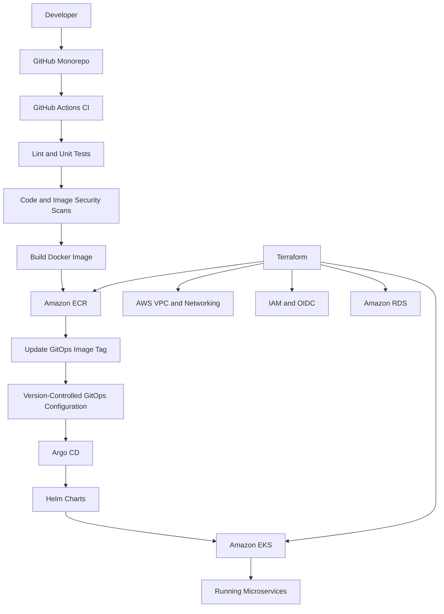

# ZenPharma — Cloud-Native DevOps & GitOps Platform

**End-to-end infrastructure automation, CI/CD, containerization, and Kubernetes-based microservices deployment on AWS.**


## 1. Project Overview

ZenPharma is a cloud-native pharmaceutical application platform built to demonstrate modern DevOps engineering practices across infrastructure provisioning, application delivery, security, deployment automation, and operational troubleshooting.

The platform uses a microservices-oriented application structure and AWS-managed infrastructure. Terraform provisions the cloud resources, GitHub Actions automates application build and delivery workflows, Amazon ECR stores container images, and Amazon EKS runs the containerized workloads.

Argo CD and Helm provide the GitOps deployment model, allowing Kubernetes applications to reconcile their running state with version-controlled deployment configuration.

### Engineering objectives

- Provision repeatable AWS infrastructure using Terraform.
- Build and publish versioned Docker images through CI/CD.
- Deploy microservices to Amazon EKS.
- Automate Kubernetes deployments through GitOps.
- Separate development validation and deployment from production release approvals.
- Apply security scanning, IAM least privilege, and secrets-management practices.
- Improve troubleshooting, observability, and infrastructure lifecycle management.

## 2. High-Level Architecture



**Infrastructure delivery and application delivery are separate workflows.**

- **Infrastructure pipeline:** provisions and manages AWS resources using Terraform.
- **Application pipeline:** validates source code, builds images, pushes them to ECR, and updates deployment configuration.
- **GitOps reconciliation:** Argo CD monitors the configured repository and reconciles Kubernetes workloads with the desired state.

The GitOps repository URL, branch, and paths must be consistent between application workflows and Argo CD applications. These settings should be verified before considering the end-to-end deployment workflow complete.

## 3. Technology Stack

| Area                         | Technologies                                   |
| ---------------------------- | ---------------------------------------------- |
| Cloud platform               | Amazon Web Services (AWS)                      |
| Infrastructure as Code       | Terraform, reusable Terraform modules          |
| Containerization             | Docker                                         |
| Container registry           | Amazon Elastic Container Registry (ECR)        |
| Container orchestration      | Amazon Elastic Kubernetes Service (EKS)        |
| CI/CD                        | GitHub Actions                                 |
| GitOps                       | Argo CD                                        |
| Kubernetes packaging         | Helm                                           |
| Database                     | Amazon RDS, MySQL                              |
| Secrets management           | AWS Secrets Manager, External Secrets Operator |
| Identity and access          | AWS IAM, GitHub Actions OIDC                   |
| Code quality                 | SonarCloud / SonarQube                         |
| Container security           | Trivy and other configured security scanners   |
| Monitoring and visualization | Prometheus and Grafana                         |
| Logging                      | Loki and other configured logging integrations |

Tool availability and configuration may vary by service and workflow.

## 4. Application Services

The repository contains the following application components:

| Service               | Responsibility                          |
| --------------------- | --------------------------------------- |
| Pharma UI             | User-facing web application             |
| API Gateway           | Application entry point and API routing |
| Auth Service          | Authentication-related operations       |
| Drug Catalog Service  | Drug catalogue management               |
| Inventory Service     | Inventory-related operations            |
| Manufacturing Service | Manufacturing-related operations        |
| QC Service            | Quality-control operations              |
| Supplier Service      | Supplier-related operations             |
| Notification Service  | Notification-related functionality      |

Each service can have its own source directory, build workflow, container image, and deployment configuration.

The precise API contracts, database relationships, and service dependencies should be documented alongside each service as those interfaces are finalized.

## 5. Repository Structure

The project follows a monorepo approach to keep application source, infrastructure code, deployment configuration, and automation in one repository.

```text
zenpharma/
├── .github/
│   └── workflows/
│       ├── ci-api-gateway.yml
│       ├── ci-auth-service.yml
│       ├── ci-drug-catalog.yml
│       ├── ci-inventory-service.yml
│       ├── ci-manufacturing-service.yml
│       ├── ci-notification.yml
│       ├── ci-pharma-ui.yml
│       ├── ci-qc-service.yml
│       ├── ci-supplier-service.yml
│       ├── ci-pr-*.yml
│       ├── _java-build.yml
│       ├── _java-pr-check.yml
│       ├── _node-build.yml
│       ├── _node-pr-check.yml
│       └── terraform.yml
│
├── backend/
│   ├── api-gateway/
│   ├── auth-service/
│   ├── drug-catalog-service/
│   ├── inventory-service/
│   ├── manufacturing-service/
│   ├── notification-service/
│   ├── qc-service/
│   └── supplier-service/
│
├── frontend/
│   └── pharma-ui/
│
├── infra/
│   ├── envs/
│   │   └── dev/
│   │       ├── main.tf
│   │       ├── variables.tf
│   │       ├── outputs.tf
│   │       └── ...
│   └── modules/
│       ├── vpc/
│       ├── ecr/
│       ├── eks/
│       ├── iam/
│       ├── rds/
│       └── secrets-manager/
│
├── gitops/
│   ├── helm-charts/
│   ├── envs/
│   │   └── dev/
│   └── ...
│
└── README.md
```

*This is a representative structure based on the project layout. Verify directory names and workflow filenames against the current repository before treating it as an exact inventory.*

## 6. AWS Infrastructure Provisioning

Terraform manages the cloud infrastructure required by the application platform.

### Core infrastructure components

- **VPC:** isolated network with public, private, and database subnets.
- **Networking:** route tables, internet connectivity, and NAT gateway configuration where required.
- **Amazon EKS:** Kubernetes control plane and managed node group.
- **Amazon ECR:** separate container repositories for application services.
- **Amazon RDS:** managed relational database infrastructure.
- **AWS Secrets Manager:** storage for application credentials and sensitive configuration.
- **IAM:** roles and policies for EKS components, application integrations, and CI/CD.
- **OIDC federation:** GitHub Actions authentication to AWS without storing long-lived AWS access keys in workflow configuration.

### Terraform workflow

The infrastructure workflow is designed to support:

1. Terraform formatting and validation.
2. Backend initialization.
3. Infrastructure planning.
4. Pull-request review of infrastructure changes.
5. Approved infrastructure application.
6. Controlled destruction for temporary development environments.

Terraform state is stored remotely in Amazon S3. The state bucket and state file must be preserved when destroying application infrastructure.

**Important:** A successful destroy must be verified against both Terraform state and actual AWS resources. An empty state alone does not prove that every resource outside the state has been removed.

## 7. Application CI/CD Pipeline

Each application workflow should follow a consistent delivery process.

1. Detect relevant source changes using branch and path filters.
2. Check out the repository.
3. Install the required runtime and dependencies.
4. Run linting and unit tests.
5. Perform configured code-quality and security checks.
6. Build the Docker image.
7. Tag the image with a unique identifier, preferably the Git commit SHA.
8. Authenticate securely to AWS.
9. Push the image to its ECR repository.
10. Update the corresponding GitOps image tag.
11. Commit the GitOps change.
12. Allow Argo CD to reconcile the application.
13. Verify rollout and application readiness.

A failed test or security gate should prevent an unapproved release from proceeding.

### Example image-tag convention

```text
<ecr-repository>:sha-<git-commit-sha>
```

Immutable or uniquely versioned image tags improve traceability and rollback capability. Avoid relying exclusively on mutable tags such as `latest`.

## 8. GitOps Deployment with Argo CD

Argo CD provides declarative continuous delivery to Kubernetes.

The desired deployment configuration is stored in Git and rendered through Helm or Kubernetes manifests.

### Intended development deployment flow

```text
Code change
    ↓
Push to develop
    ↓
GitHub Actions CI
    ↓
Tests and security checks
    ↓
Build and push image to ECR
    ↓
Commit updated image tag to GitOps
    ↓
Argo CD detects the Git change
    ↓
Helm renders the desired configuration
    ↓
EKS rolls out the updated application
    ↓
Verify rollout and health
```

### GitOps configuration requirements

- Every application must point to the correct repository URL.
- The configured branch or revision must match the intended environment.
- Each Argo CD application must reference the correct chart and values file.
- Automated sync and self-healing should be enabled where appropriate.
- Pruning should be configured carefully to avoid deleting resources unintentionally.
- The CI workflow must update the same GitOps source that Argo CD monitors.

Normal application releases should not require manually applying Kubernetes manifests using `kubectl`.

`kubectl` remains useful for operational diagnosis, including inspecting pods, logs, events, and rollout status.

## 9. Branching and Release Strategy

The intended release policy separates development delivery from production release approval.

| Event                     | Expected behaviour                                                               |
| ------------------------- | -------------------------------------------------------------------------------- |
| Feature branch push       | Run applicable validation checks                                                 |
| Pull request to `develop` | Validate changes before integration, if configured                               |
| Push to `develop`         | Build and deploy to the development environment through CI/CD and GitOps         |
| Pull request to `main`    | Run required checks and review proposed changes                                  |
| Merge to `main`           | Release candidate or production release workflow, according to configured policy |
| Production approval       | Permit production deployment after required review and checks                    |

Production deployment should use a separate environment configuration and approval gate. A merge to `main` should not accidentally deploy development configuration into production.

The actual triggers, required checks, environment protection rules, and deployment permissions must be verified in GitHub Actions before this policy can be considered fully implemented.

## 10. Security and Reliability Practices

The project is intended to demonstrate security-conscious DevOps practices.

- Use GitHub Actions OIDC federation for short-lived AWS credentials where supported.
- Apply least-privilege IAM policies.
- Store application secrets in AWS Secrets Manager rather than source control.
- Scan application code and container images using configured security tools.
- Keep sensitive Terraform variables out of source control and workflow logs.
- Use unique image tags and maintain traceability from Git commit to deployment.
- Protect production environments with approvals and restricted deployment permissions.
- Review Terraform plans before applying infrastructure changes.
- Preserve remote Terraform state and inspect AWS resources after failed destroys.
- Use readiness checks, logs, events, and rollout status to diagnose application failures.

## 11. Monitoring and Troubleshooting

Prometheus and Grafana can provide metrics and visualizations for configured Kubernetes workloads. Logging integrations such as Loki can centralize application and platform logs.

Operational troubleshooting should follow a consistent sequence:

1. Identify the failed pipeline, deployment, or infrastructure resource.
2. Inspect the relevant GitHub Actions logs or Terraform output.
3. Check the desired state in Git.
4. Inspect Argo CD sync and health status.
5. Inspect Kubernetes events, pod status, and application logs.
6. Validate image availability, configuration, secrets, IAM permissions, and network connectivity.
7. Apply the smallest safe correction.
8. Verify recovery and document the root cause.

For infrastructure deletion, check AWS dependencies such as network interfaces, NAT gateways, load balancers, security groups, and subnets before retrying failed VPC cleanup.

## 12. Getting Started

### Prerequisites

Install and configure:

- Git
- AWS CLI
- Terraform
- Docker
- `kubectl`
- Helm
- Access to the AWS account and GitHub repository

Argo CD CLI is optional if you use the Argo CD UI or Kubernetes resources to inspect application status.

### Clone the repository

```bash
git clone https://github.com/MoinRazvi/zenpharma.git
cd zenpharma
```

### Configure AWS credentials

Use an approved AWS authentication method and confirm the active account:

```bash
aws sts get-caller-identity
aws configure list
```

Do not commit AWS access keys, passwords, tokens, or secret values to the repository.

### Initialize Terraform

```bash
cd infra/envs/dev
terraform init
terraform fmt -check -recursive
terraform validate
terraform plan
```

Review the plan before applying it.

Provisioning should be performed through the approved Terraform workflow when that is the project's configured deployment process. Ensure the remote backend, IAM permissions, required variables, and environment approval rules are configured first.

### Configure Kubernetes access

After the EKS cluster has been provisioned successfully:

```bash
aws eks update-kubeconfig \
  --region us-east-1 \
  --name pharma-dev-cluster
```

Verify access:

```bash
kubectl get nodes
kubectl get namespaces
```

These commands are for connection verification and operations—not for manually deploying application changes.

## 13. Validation Checklist

Before considering an environment ready, verify:

- [ ] Terraform plan is reviewed and infrastructure provisioning succeeds.
- [ ] EKS cluster and managed nodes are healthy.
- [ ] ECR repositories exist and required images are available.
- [ ] Application CI workflows pass their required checks.
- [ ] GitOps configuration points to the correct repository, branch, chart, and values.
- [ ] Argo CD applications are synchronized and healthy.
- [ ] Kubernetes deployments have the expected number of ready replicas.
- [ ] Application endpoints and required service-to-service connections work.
- [ ] Secrets, IAM permissions, and database connectivity are verified.
- [ ] Logs and monitoring provide sufficient visibility into failures.
- [ ] Infrastructure destruction and state reconciliation are verified before rebuilding.

## 14. Current Engineering Focus

The next improvement phase is to standardize the GitOps source of truth and validate the end-to-end application delivery process.

Key priorities:

1. Align GitHub Actions image-tag updates with the repository and branch watched by Argo CD.
2. Ensure each service workflow uses the correct source paths, image repository, and GitOps values file.
3. Validate automatic deployment to the development environment after a successful push to `develop`.
4. Enforce review, merge, and environment approval controls for production releases.
5. Test a complete application change from source commit to healthy EKS deployment without manual manifest application.
6. Make infrastructure recreation and cleanup repeatable through Terraform.

## 15. Project Outcome

ZenPharma is a hands-on platform engineering project focused on applying infrastructure automation, container orchestration, CI/CD, GitOps, cloud security, and systematic troubleshooting to a microservices application.

The objective is to establish a repeatable delivery model in which infrastructure is managed as code, application changes move through controlled pipelines, and Kubernetes deployments reconcile automatically from version-controlled configuration.

**Core principle:** Build repeatable infrastructure, automate application delivery, keep deployment configuration in Git, and make every release traceable and verifiable.

---

